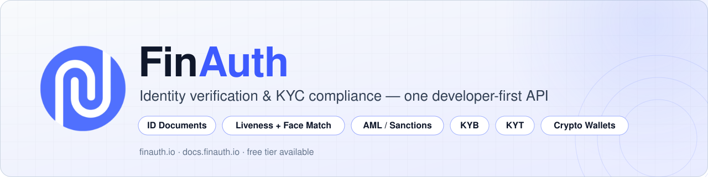

  <a href="https://finauth.io">
    <picture>
      <source media="(prefers-color-scheme: dark)" srcset="./banner-dark.svg">
      <source media="(prefers-color-scheme: light)" srcset="./banner-light.svg">
      
    </picture>
  </a>

  
  &nbsp;

<h3 align="center">Verify real people and real businesses in minutes, not months.</h3>

  FinAuth gives fintechs, exchanges, marketplaces and regulated businesses every KYC and compliance check 
  behind <b>one API</b>: create a session, send your user through a hosted flow, and get the decision by signed webhook.

 

## 🧰 What you can verify

| | Capability | What it does |
|:--:|---|---|
| 🪪 | **ID document verification** | Authenticate passports, ID cards and driver's licences |
| 🤳 | **Biometric verification** | Passive liveness plus selfie-to-ID face match |
| 🎂 | **Age estimation** | Low-friction age gates with document fallback |
| 🚨 | **AML / PEP / sanctions screening** | Screen customers against watchlists |
| 🏢 | **KYB** | Business lookup plus UBO and ownership checks |
| 💸 | **Transaction screening (KYT)** | Monitor transactions for risk |
| 🪙 | **Crypto wallet screening** | Assess the risk of wallet addresses |
| 🔁 | **Reusable sessions** | Verify once, reuse the result |
| 📱 | **Hosted flows (link or QR)** | Hand users from desktop to their phone camera |
| 🔐 | **Signed webhooks** | Tamper-proof decisions delivered to your backend |

## 🎯 Built for your industry

| If you are… | Start here |
|---|---|
| 🏦 A neobank, wallet or payments app | [Fintech Onboarding](https://github.com/FinAuth-SDK/finauth-use-cases/blob/main/use-cases/fintech-onboarding.md) |
| ₿ A crypto exchange or VASP | [Crypto Exchange KYC](https://github.com/FinAuth-SDK/finauth-use-cases/blob/main/use-cases/crypto-exchange-kyc.md) |
| 🛒 A marketplace or gig platform | [Marketplace Verification](https://github.com/FinAuth-SDK/finauth-use-cases/blob/main/use-cases/marketplace-verification.md) |
| 🔞 Selling age-restricted goods or content | [Age Verification](https://github.com/FinAuth-SDK/finauth-use-cases/blob/main/use-cases/age-verification.md) |
| 🤝 Onboarding companies, not consumers | [KYB: B2B Onboarding](https://github.com/FinAuth-SDK/finauth-use-cases/blob/main/use-cases/kyb-business-onboarding.md) |

## 📚 Free open-source resources

<table>
  <tr>
    <td width="50%" valign="top">
      <h4>🌟 <a href="https://github.com/FinAuth-SDK/awesome-identity-verification">Awesome Identity Verification</a></h4>
      A curated list of KYC, AML and biometric resources: APIs, open-source tools, standards and regulations.  
      
    </td>
    <td width="50%" valign="top">
      <h4>📖 <a href="https://github.com/FinAuth-SDK/kyc-compliance-handbook">KYC Compliance Handbook</a></h4>
      A practical guide to KYC, KYB, AML screening, KYT and biometric verification for regulated businesses.  
      
    </td>
  </tr>
  <tr>
    <td width="50%" valign="top">
      <h4>🛠️ <a href="https://github.com/FinAuth-SDK/identity-verification-api-guide">Identity Verification API Guide</a></h4>
      Hosted sessions, webhooks, QR hand-off, API key security and a go-live checklist.  
      
    </td>
    <td width="50%" valign="top">
      <h4>📈 <a href="https://github.com/FinAuth-SDK/digital-onboarding-best-practices">Digital Onboarding Best Practices</a></h4>
      Reduce KYC drop-off with mobile-first verification, risk-based friction and GDPR-conscious data handling.  
      
    </td>
  </tr>
  <tr>
    <td colspan="2" valign="top">
      <h4>💼 <a href="https://github.com/FinAuth-SDK/finauth-use-cases">FinAuth Use Cases</a></h4>
      Step-by-step walkthroughs for fintech onboarding, crypto exchange KYC, marketplace trust, age verification and B2B KYB.&nbsp;
      
    </td>
  </tr>
</table>

## 📩 Contact Us

Contact us for integration support, pricing and compliance questions about the FinAuth identity verification API.

  

---

   
  <b>Ready to verify your first user?</b>  
  
  

